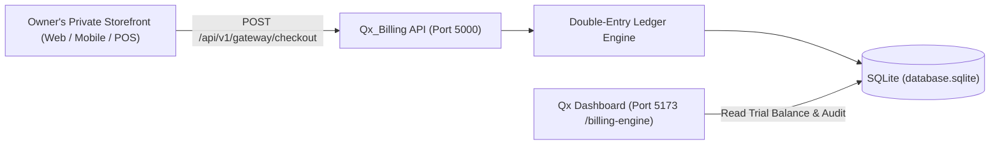

# Private Owner Storefront & Universal BSS Canvas Guide

This guide details how to run the **Qx_Billing** platform locally as a private, owner-operated billing engine and double-entry general ledger canvas.

---

## 1. Local-Only Execution Architecture

You do not need an external or remote cloud server. The entire stack runs on `localhost` with zero external dependencies:



### Launching the Stack Locally
Run the startup script in [`Qx_Billing`](file:///c:/Users/ADMIN/Documents/GitHub/Qx_Billing):
```cmd
start_servers.bat
```
* **Backend API**: `http://localhost:5000`
* **Frontend Operations Dashboard**: `http://localhost:5173`
* **Ledger Canvas & Trial Balance**: `http://localhost:5173/billing-engine`

---

## 2. Configuring Your Private Business Canvas

Visit `http://localhost:5173/billing-engine` and click **"Configure Business Canvas"**:
1. **AI Smart Onboarding Assistant**: Paste a plain English description of your business (e.g. *"We run a private studio selling bespoke home hardware in USD with 10% sales tax"*). Click **"Auto-Fill Form"**.
2. **Review & Confirm**:
   * **Business Name & Legal Entity**
   * **Operational Archetype**:
     * `retail`: Physical goods, inventory, courier tariffs, COGS.
     * `saas`: Subscriptions, MRR/ARR, deferred revenue, cloud costs.
     * `services`: Turnkey milestones, unbilled WIP, contractor costs.
     * `usage`: Metered telemetry, CDR accruals, carrier transit.
   * **Base Currency**: `USD`, `KES`, `EUR`, `GBP`.
   * **Tax Rules**: Tax Name (`VAT`, `Sales Tax`) & Rate (e.g. `0.16` for 16%, `0.10` for 10%, or `0.00`).
3. Click **"Save & Re-Seed Ledger"**.

---

## 3. Headless Checkout Gateway API for Your Private Store

Your private storefront can send orders directly into Qx_Billing:

### `POST /api/v1/gateway/checkout`

#### Example Request Payload:
```json
{
  "storeId": "my-private-store",
  "customer": {
    "name": "Sarah Connor",
    "email": "sarah@cyberdyne.org",
    "phone": "+1-555-0142",
    "address": "404 Industrial Blvd, Sector 7"
  },
  "items": [
    {
      "productId": "PRD-001",
      "title": "Industrial Titanium Casing",
      "unitPrice": 450.00,
      "quantity": 1
    },
    {
      "productId": "PRD-002",
      "title": "Hydraulic Pressure Sensor",
      "unitPrice": 75.00,
      "quantity": 2
    }
  ],
  "shippingFee": 25.00,
  "paymentMethod": "card",
  "paymentReceipt": "TXN-984321-AUTH",
  "notes": "Urgent courier dispatch requested"
}
```

#### What Qx_Billing Automatically Executes:
1. **Customer Resolution**: Reconciles or creates customer in the local database by phone or email.
2. **Tax & Total Math**: Computes item net amounts, tax breakdown according to your active `BusinessProfile` rules, and shipping fees.
3. **Double-Entry General Ledger Posting**:
   * **DEBIT** `1020` (Bank & Payment Gateway Clearing): Full order total.
   * **CREDIT** `4010` (Merchandise Sales Revenue): Net item price.
   * **CREDIT** `2200` (Sales Tax / VAT Output Liability): Exact tax collected.
   * **CREDIT** `4100` (Shipping & Logistics Revenue): Shipping fee (if applicable).
   * **Invariant Checked**: $\sum \text{Debits} \equiv \sum \text{Credits}$.
4. **Order & Invoice Generation**: Produces an immutable `Order`, `OrderLine` items, `Payment` receipt, and `Invoice` record.

#### Example Response:
```json
{
  "success": true,
  "orderNumber": "ORD-123456-789",
  "order": {
    "id": 1,
    "orderNumber": "ORD-123456-789",
    "subtotal": 600.00,
    "shippingTotal": 25.00,
    "taxTotal": 60.00,
    "total": 685.00,
    "currency": "USD",
    "status": "paid"
  },
  "journalEntry": {
    "entryNumber": "JE-ORD-123456-789",
    "isBalanced": true,
    "totalAmount": 685.00
  },
  "invoice": {
    "invoiceNumber": "INV-ORD-123456-789",
    "amountDue": 685.00,
    "status": "paid"
  }
}
```

---

## 4. Querying Orders & Ledger Audits

* **List Orders**: `GET http://localhost:5000/api/v1/gateway/orders`
* **Single Order Detail**: `GET http://localhost:5000/api/v1/gateway/orders/:orderNumber`
* **Real-time Trial Balance**: `GET http://localhost:5000/api/ledger/trial-balance`
* **Journal Entries Audit**: `GET http://localhost:5000/api/ledger/journal-entries`
